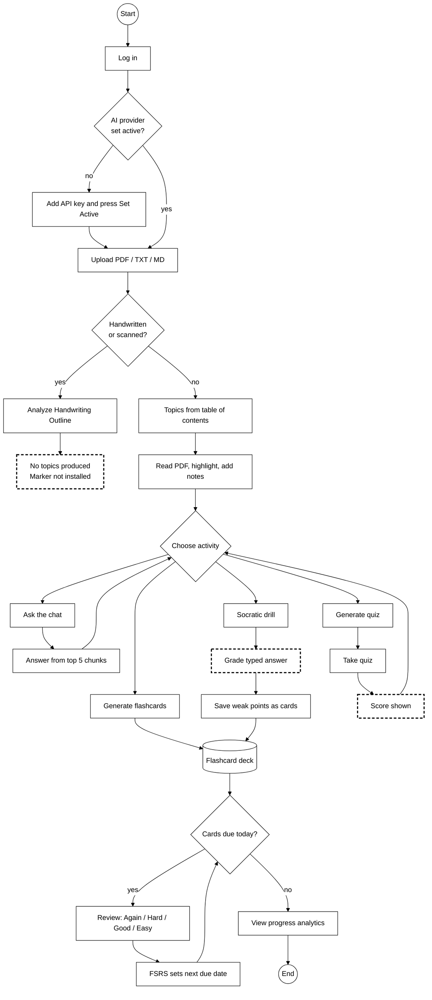

# 12 · Activity diagram: a student's study workflow

The main path through the app, from upload to spaced review, with the points where it branches. Dashed boxes are steps that fail in the current build (from Rony's testing and the code review).

Failing steps: handwriting analysis produces nothing, drill grading uses an empty prompt, and the quiz score display divides the wrong numbers.

SVG export (black and white): [12-activity-study-workflow.svg](12-activity-study-workflow.svg)
